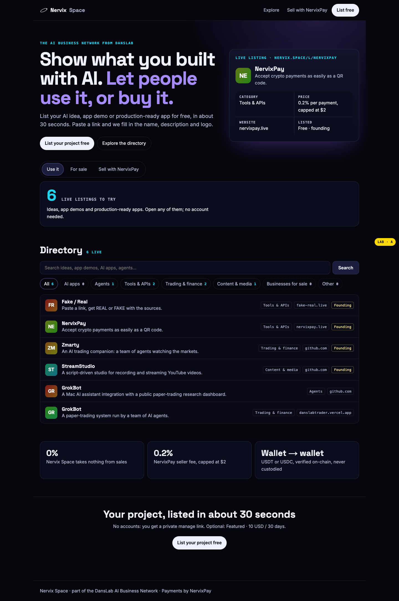
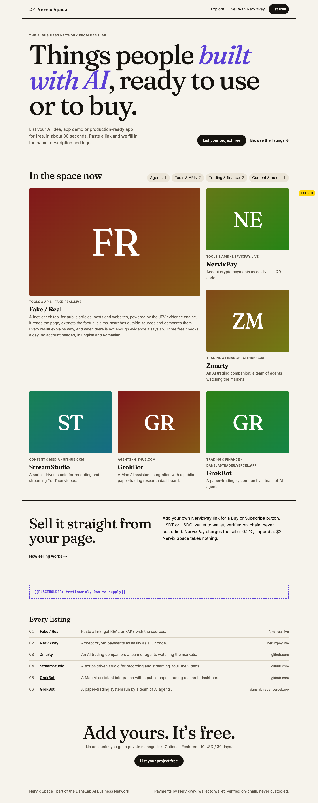
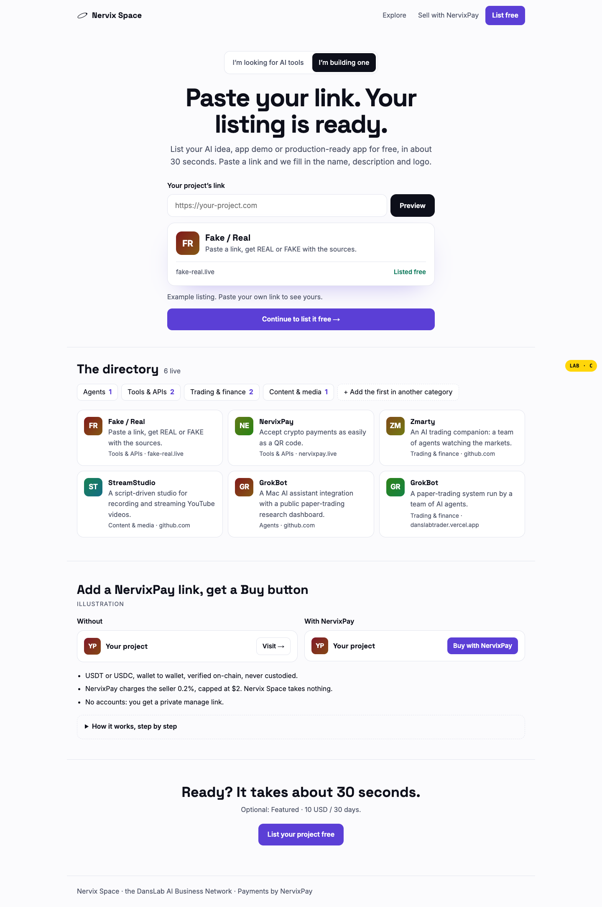

# Checkpoint 2: three directions

The mocks were real routes on this branch (`/lab`, `/lab/a`, `/lab/b`, `/lab/c`; `?for=build` showed the paste
demo), visible on previews only. They were removed once C with A's identity was picked; commit d56f465 has them.
All three used the six live public listings and only the brief's claims. The one placeholder was
in B: `[[PLACEHOLDER: testimonial, Dan to supply]]`.

The screenshots are full-page Playwright captures (reduced motion on, light colour scheme) at 1440×900 and 390×844, in
[`lab/`](lab/). Measurements come from a production build (`next build && next start`) on 16 Nov 2026.

| | A · Mission Control | B · Gallery | C · Live Network |
|---|---|---|---|
| Page height, 1440 / 390 | 2,171 / 3,884 px | 3,631 / 5,954 px | 1,862 / 2,961 px (looking) |
| Directory starts at, 1440 / 390 | 858 / **1,468** px | 718 / 693 px | **525 / 605** px |
| Route JS (first load) | 740 B (107 kB) | 658 B (107 kB) | 2.98 kB (109 kB) |
| axe, WCAG 2.2 AA | 0 | 0 | 0 |
| Horizontal scroll at 390 | none | none | none |
| Animation | none | none | none |
| Fonts | Space Grotesk + Inter | Fraunces + Inter | Space Grotesk + Inter |

The shared 103 kB first-load JS is the current Next/React baseline. It is not from the labs.

## A · Mission Control

- **Works:** It keeps the brand people already know, and the stars are now static, so they cost no frame time. The
  live-listing readout is product proof in the hero. The instrument rows scan fast and keep the two GrokBots apart
  (monogram colour + host). The trust strip makes 0% / 0.2% capped at $2 / wallet-to-wallet impossible to miss.
- **Doesn't:** On a phone the readout card sits above the directory, which still starts at 1,468 px. That's barely
  better than today's ~1,450 px, so finding 3 isn't solved on mobile. Mono uppercase labels everywhere get noisy.
  The mode gauge ("6 live listings") is a weak figure while the network is small.
- **Fix if chosen:** On mobile, drop the readout below the directory, or shrink it to a single row.

## B · Gallery

- **Works:** It is the most distinctive and memorable of the three, and the serif headline has real presence. The
  plain text index (the A24 idea) is the fastest way to see every listing. Light-first, with a dark scheme that follows
  the system.
- **Doesn't:** Without real logos or screenshots, six huge monogram plates *are* the page: colour blocks with letters,
  not products. The mobile page is the longest (5,954 px). The big feature tile ranks one listing above the others with
  no reason (it is simply the first one). It also drops most of the space identity built so far.
- **Fix if chosen:** Plates need real screenshots, which means a new image source per listing, which is a data
  change. Without that, B looks empty.

## C · Live Network

- **Works:** The product is the hero. "I'm building" shows the paste-a-link preview, which calls `/api/prefill`
  read-only and never publishes. "I'm looking" puts search first, and the directory starts at 525 px on desktop and
  605 px on a phone (about 845 px higher than today). The one upfront choice sets the copy, the CTA and the final
  section. The before/after card shows exactly what a NervixPay link adds. The "How it works" notes open on demand.
  It has the shortest page and works without JS, except for the preview.
- **Doesn't:** It has the least atmosphere and could pass for a generic SaaS page. The space identity survives only in
  the logo. It has the most client JS of the three (+2.98 kB, still far under budget).
- **Fix if chosen:** Bring A's dark tokens back as C's dark scheme, use A's mono data labels sparingly, and let the
  orbit mark be the single memorable object, at hero size, static, with one transform-only motion that is off under
  reduced motion.

## Recommendation: C, with A's identity

B and C both bring the directory within one phone screen (693 and 605 px, against about 1,450 today), but only C also puts
product proof in the hero (finding 3) without needing new per-listing images (finding 4). It also has room to spare
on the performance budget. Its weakness, a lack of character, is the cheapest one to fix,
because A already defines the tokens, mono labels and starfield that give the site its character. B is the most beautiful at
1440, but it depends on per-listing imagery we don't have.

If you pick C, step 3 starts with tokens (A's palette as C's dark theme, C's palette as light), then layout and nav,
then the home page built from C.

## Notes
- Monograms come from `lib/monogram.ts`, which is tested: deterministic per slug, the two GrokBots get different hues,
  and the letters keep ≥ 4.5:1 contrast against both gradient stops.
- `app/logo.tsx` gained an optional `ring` colour so the mark is visible on light backgrounds. The current site uses
  the default, so it is unchanged.
- In the labs, chip links and the search form don't filter. They are layout mocks only.
- The lab routes were deleted in step 3.
